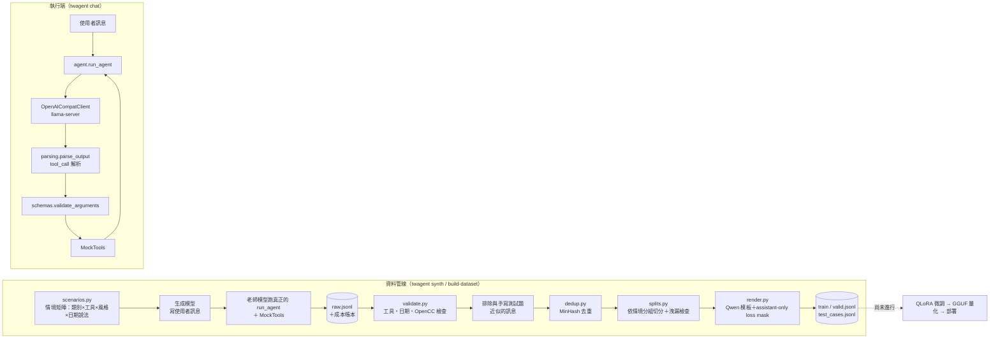

# lora-toolcall-tw

繁體中文 Function Calling Agent（臺灣生活助理）：用老師模型合成工具呼叫軌跡、嚴格驗證過濾，
準備用 QLoRA 微調小型 Qwen 模型，讓它在 4 GB 顯卡（GTX 1050 Ti）上本機可靠地把繁中口語轉成工具呼叫。

> **目前進度：Agent 執行層與資料管線完成；QLoRA 微調、評估、量化部署尚未進行。**
> repo 內還沒有訓練程式（沒有 Unsloth／PEFT／TRL 相依），也沒有微調模型或評估結果。
> 已完成的實測只有：原始 Qwen3 模型在 GTX 1050 Ti 上用 llama-server 執行的硬體驗證，以及兩次各 50 筆的老師模型試算。
> 本頁只列 repo 內有紀錄的數字，尚未完成的部分不填結果。

## 要解決的問題

小模型（1.7B–4B）可以塞進便宜的顯卡，但直接拿來做 function calling 會出錯，例如原始模型冒煙測試中看到的
datetime 多帶秒數而不符 schema、回覆混用「臺／台」（見 `docs/spike-w1.md`）。這個專案要做的是：

1. 一個可測試、模型無關的 Agent 迴圈（解析 → schema 驗證 → 執行工具 → 重試／退回備援模型）。
2. 一條**可控成本、可追溯、不洩漏測試集**的訓練資料管線，給後續 QLoRA 微調使用。

工具場景（7 個 mock 工具，`src/twagent/tools/`）：天氣、高鐵、台鐵、YouBike、統一發票對獎、行事曆新增／查詢（in-memory SQLite）。

## Demo

目前沒有 UI；以下是不需要 GPU 或 API key 就能重現的 CLI 實際輸出（檢查 100 筆手寫測試題的格式與標準答案）：

```text
$ twagent check-cases data/handwritten_test.jsonl
100 valid case(s): clarify=15, no_tool=15, parallel=15, sequential=15, single=35, tool_error=5
```

原始模型（未微調的 Qwen3-4B，Q4_K_M）跑 `twagent chat` 的五題冒煙測試結果與觀察，記錄在
[`docs/spike-w1.md`](docs/spike-w1.md)（需要本機 llama-server，無法在 CI 重現）。

## 架構



## 技術重點

- **老師模型走同一個 Agent 迴圈**（`data/synth.py`）：老師模型不是直接「寫」對話，而是跑真正的 `run_agent`，
  工具結果一律來自 mock，循序任務自然看得到上一步結果。老師沒有重試機會（`parse_retries=0`、`schema_retries=0`），
  所以訓練資料裡不會出現「模型修正自己錯誤」的示範。
- **自己渲染 Qwen chat template ＋ assistant-only loss mask**（`render.py`）：輸出帶 `train` 旗標的片段，
  只有 assistant 內容與其 `<|im_end|>` 參與 loss；與 GGUF 內嵌模板的渲染結果用 fixture 逐字元鎖住
  （`tests/fixtures/qwen_*.txt`、`tests/test_template_fixture.py`，比對過程見 `docs/spike-w1.md`）。
- **驗證器把關**（`data/validate.py`）：檢查是否正常結束且老師沒出錯、呼叫的工具與類別相符、相對日期換算與
  `dates.py` 一致、OpenCC s2twp 偵測簡體／中國用語、使用者訊息不得洩漏工具名稱。
- **防止測試集污染**（`data/build.py`、`data/splits.py`）：先排除與 100 筆手寫測試題近似的合成訊息；
  切分依情境（類別＋工具組合＋說話風格）分組，`SplitResult` 建構時就檢查跨 split 的組別重疊與近似重複，
  有洩漏就無法建立。
- **MinHash 去重**（`data/dedup.py`）：字元 3-gram、忽略標點與空白，LSH 找候選後再用 Jaccard 估計確認。
- **成本控管**（`data/commands.py`、`data/synth.py`）：先 50 筆試算保留率與每筆成本，再推估正式合成量；
  有預算上限、每批寫入成本帳本，中斷後可續跑（append-only JSONL，自動修復被截斷的最後一行）。
- **Agent 迴圈的防呆**（`agent.py`）：同一輪的工具呼叫先全部通過 schema 驗證才執行，避免半套執行後重送造成重複；
  解析失敗與 schema 錯誤有重試上限，用完可退回備援模型；`max_steps` 防止無限迴圈。

## 成果與數字

**目前沒有微調模型的評估數字。** repo 內有紀錄的實測如下：

硬體驗證（[`docs/spike-w1.md`](docs/spike-w1.md)，llama-server Docker CUDA 版，`-ngl 99` 全部層 offload）：

| 模型（Q4_K_M） | VRAM 用量 | 生成速度 |
|---|---|---|
| Qwen3-4B-Instruct-2507 | 3691 / 4096 MiB | 20.4 tokens/s |
| Qwen3-1.7B | 2225 / 4096 MiB | 40.9 tokens/s |

老師模型試算（[`docs/data-report.md`](docs/data-report.md)，各 50 筆）：

| 版本 | 保留率 | 花費 | 差異 |
|---|---|---|---|
| v1 | 30.0% | $0.0058 | 原系統提示 |
| v2 | 60.0% | $0.0070 | 依 v1 退件原因補上發票期別、「選填參數沒提到就省略」等人設規則 |

- v1 的 35 筆退件中約 18 筆是「為了選填參數追問而不呼叫工具」；分析退件原因後修改人設與情境，保留率從 30% 提升到 60%。
- 依 v2 推估：train_target 3,000 筆需正式合成約 6,900 筆，花費約 $0.97，低於 $5 預算。
- **正式合成資料未納入版控**（`data/synthetic/` 在 `.gitignore`），repo 內也沒有正式合成的執行紀錄，
  因此不列正式合成、驗證後與切分後的筆數。

測試：`pytest -m "not live"` 共 249 個測試通過（本機 Python 3.12）；CI 在 Python 3.10–3.12 跑 `ruff` 與測試
（`.github/workflows/ci.yml`）。

## 如何執行

```bash
uv venv .venv
uv pip install -p .venv -e ".[dev]"
.venv/Scripts/python -m pytest -m "not live"   # Windows；Linux/macOS 用 .venv/bin/python
```

CLI：

```bash
twagent check-cases data/handwritten_test.jsonl              # 不需 GPU／API key
twagent chat "明天台中會下雨嗎" --today 2026-09-23 --json   # 需要啟動 llama-server
twagent synth --pilot 50                                     # 需要 OPENAI_API_KEY（放在 .env）
twagent build-dataset                                        # 讀 data/synthetic/raw.jsonl：驗證、去重、切分、格式化
```

只有 `twagent synth` 需要環境變數 `OPENAI_API_KEY`，可設在環境變數或執行目錄的 `.env`（已列在 `.gitignore`，
可由 `.env.example` 複製）。`chat` 連線的 llama-server 位址（`llm.base_url`）在 `configs/default.yaml` 設定。

## 已知限制與下一步

- **尚未訓練**：repo 內沒有訓練程式、沒有微調模型，也沒有任何微調後的準確率；目前無法宣稱微調有效。
- **正式合成資料未納入版控**：`docs/data-report.md` 的「正式合成」與「抽查」兩節仍待資料重建後填寫。
- **模板只對 Qwen3-4B 驗證過**：`scripts/check_template.py` 的逐字元比對尚未針對 Qwen3-1.7B 執行。
- **工具都是 mock**：`tools.mode: live` 尚未實作。
- 下一步：QLoRA 訓練（使用 `render.py` 的 loss mask）→ 與原始模型（B0）、few-shot（B1）在手寫與合成測試集上對照
  → 合併、GGUF 量化 → 在 1050 Ti 上部署並並排比較。

## 我負責的部分

獨立完成：需求定義、架構設計、Agent 迴圈與工具實作、資料管線、硬體驗證、測試與 CI、文件。

## 授權

MIT，見 [LICENSE](LICENSE)。
